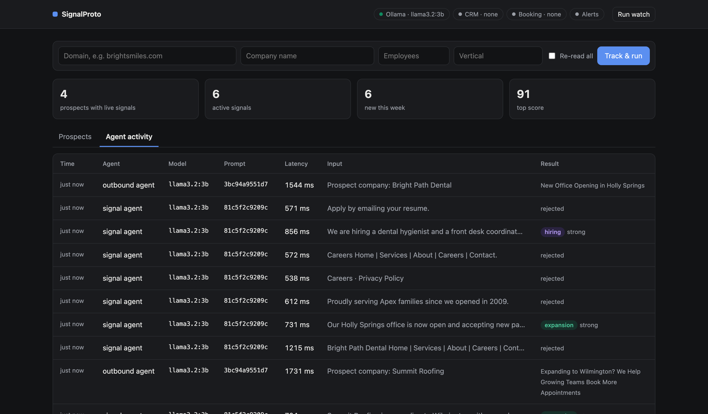

# SignalProto

Open-source multi-agent prospecting on **local models**. A **signal agent** watches prospect websites for hiring and expansion triggers. An **outbound agent** drafts a grounded email that offers **real meeting slots**. Results are ranked, traced and written back to your **CRM**. Everything runs behind a **FastAPI** REST API on Ollama, so there is no per-call API cost.

```
CRM accounts ─► watch (daily) ─► changed pages only ─► signal agent ─► new signals ─► gate ─► outbound agent (+ live slots) ─► CRM note / alert
                                                                         └─► prospect score ─► ranked dashboard
```


<sub>Demo data from `python -m demo.seed`: fictional `.example` sites run through the real pipeline and a local `llama3.2:3b`. Bright Path Dental changed between two runs. Its new hiring post was picked up and the old announcement marked stale. Copper Kettle Bakery is missing because all of its keyword hits ("all positions have been filled", "our client just opened a new location") were rejected.</sub>



<sub>Every LLM call is traced with its agent, model, prompt version and latency, and shows whether the candidate was accepted or rejected.</sub>

## Signal agent vs. keyword matching

Both systems share the same keyword list, so they flag the same candidate sentences. The difference is that the agent asks a local model to verify each candidate in context.

Results on `eval/signals_labeled.jsonl`: 80 sentences, 40 of them real signals. A prediction counts only if the signal **type** is also right.

| | Precision | Recall | F1 | False positives |
|---|---|---|---|---|
| Keyword matching | 0.52 | 0.98 | 0.68 | 36 |
| Signal agent, `llama3.2:1b` | 0.84 | 0.80 | 0.82 | 6 |
| **Signal agent, `llama3.2:3b`** | **0.95** | **0.88** | **0.91** | **2** |

Mean verification latency is about 0.6 s per candidate on an Apple-silicon laptop. Per-example errors are in `eval/results/`.

> Caveat: the eval set is small and hand-written, and the keyword list was widened after seeing it (that helps the baseline's recall as much as the agent's). Treat these numbers as directional. Grow the set with labeled sentences from real crawls before quoting them anywhere.

## The product loop

**Change detection.** Each run hashes every page. Unchanged pages skip the LLM entirely, and their signals just get a fresh `last_seen` date. Signals are fingerprinted by domain, type and normalised snippet (dates and punctuation stripped), so only genuinely **new** signals reach the outbound agent. A signal that disappears from a re-read page is marked **stale**. `watch` sweeps every tracked account, pulls new ones from the CRM, and posts new signals to an alert webhook (Slack, Zapier, n8n).

```bash
# crontab: every weekday at 7am
0 7 * * 1-5  cd /path/to/SignalProto && .venv/bin/python -m src.app watch --sync-crm
```

**Prospect scoring.** A transparent weighted sum, so every rank can be explained (see the breakdown in the dashboard):

| Component | Meaning |
|---|---|
| signal | strongest signal's confidence × type weight (expansion 1.0, hiring 0.8) |
| diversity | share of signal types present (hiring *and* expansion beats either one) |
| recency | weekly decay since the newest signal was first seen |
| size | 1.0 inside the ICP employee range, 0.2 outside, 0.5 unknown |
| fit | ICP vertical match; 0.5 when unknown or no preference |

Weights and ICP settings live in `configs/config.yml`. Learned weights are the next step once there's outcome data (replies, meetings).

**Observability and the CI eval gate.** Every LLM call is written to the `llm_calls` table and tagged with the run's trace id. The `prompt_version` is a hash of the system prompt plus few-shot examples, so editing a prompt changes it automatically. The eval runs in two modes:

| Workflow | When | How |
|---|---|---|
| `ci.yml` | every PR / push | replays recorded outputs (`eval/cassettes/`) with no model server and gates against `eval/baseline.json`. If a prompt changed without re-recording, it fails loudly. |
| `eval-live.yml` | nightly, on demand, and on prompt or eval changes | installs Ollama, runs `llama3.2:3b` live, gates with a wider tolerance |

```bash
python -m eval.run_eval --model llama3.2:3b --record          # after changing a prompt: re-record live
python -m eval.run_eval --model llama3.2:3b --replay --gate   # what CI runs
python -m eval.run_eval --model llama3.2:3b --write-baseline  # accept new scores as the bar
```

## Features
- **LangGraph pipeline:** crawl → signal agent → gate → outbound agent → CRM sync (see [flow.md](flow.md)).
- **Structured outputs:** the LLM is constrained to Pydantic JSON schemas through Ollama's `format`, so there is no regex-parsing of model text.
- **Meeting booking:** Cal.com v2 (live slots spread across days, plus `POST /meetings/book`) or any scheduling link. Slots are inserted by code, so the model can't invent a time.
- **CRM adapters:** HubSpot (pull companies with size and industry, write notes on the company record), a generic webhook (Zapier, Make or n8n into Salesforce, Pipedrive, Attio and others), and CSV. Adding a CRM means implementing two methods.
- **SQLite store** with versioned migrations: accounts, page snapshots, signals, outreach drafts, LLM calls.
- **Dashboard** served by the API at `/`, with no build step and no extra dependencies.
- **Tests:** 38 pytest tests, with the LLM and HTTP faked.

## Quickstart

```bash
python3.11 -m venv .venv && source .venv/bin/activate
pip install -r requirements.txt
ollama pull llama3.2:3b          # Ollama must be running on :11434
```

**See it with demo data**
```bash
python -m demo.seed                                     # runs the real pipeline on fixture sites -> data/demo.db
SIGNALPROTO_DB=data/demo.db uvicorn src.api.main:app    # open http://localhost:8000
```

**Use it for real**
```bash
uvicorn src.api.main:app --reload                       # dashboard at /, API docs at /docs
python -m src.app run --csv data/companies.sample.csv   # columns: domain, company, [employees], [vertical]
python -m src.app watch --sync-crm                      # the scheduled loop
python -m src.app prospects                             # ranked list in the terminal
```

| Method | Path | Purpose |
|---|---|---|
| GET | `/` | Dashboard |
| GET | `/health` | Ollama reachability, models, CRM, booking and alert configuration |
| POST | `/pipeline/run` | Track an account and run it (`force`, `sync_crm` optional) |
| POST | `/watch/run` | Sweep all tracked accounts, alert on new signals |
| GET | `/prospects` | Ranked prospects with score breakdowns |
| GET | `/prospects/detail?domain=` | Signals, stale signals, outreach drafts |
| GET | `/traces?trace_id=` | Logged LLM calls |
| POST | `/signals/detect` | Stateless crawl + signal agent (nothing stored) |
| GET | `/meetings/slots` | Open slots from the booking provider |
| POST | `/meetings/book` | Book a slot (Cal.com) |

## Configuration
`configs/config.yml` covers crawl paths, gate, freshness, models, sender, booking, CRM, storage, alerts and scoring/ICP. Secrets come only from the environment:

| Env var | Used for |
|---|---|
| `OLLAMA_BASE_URL` | default `http://localhost:11434` |
| `CALCOM_API_KEY` | `booking.provider: calcom` (plus `calcom_event_type_id`) |
| `HUBSPOT_TOKEN` | `crm.provider: hubspot` (private-app token: companies read, notes write) |
| `SIGNALPROTO_CONFIG` | alternate config path |
| `SIGNALPROTO_DB` | alternate database path (e.g. `data/demo.db`) |

## Layout
```text
src/
  api/main.py              FastAPI app
  web/index.html           dashboard
  graph.py                 LangGraph pipeline, change detection, dependency wiring
  watch.py                 scheduled sweep, alerts, ranked prospects
  scoring.py               prospect score
  store.py                 SQLite store + migrations
  crawler.py               deterministic fetcher
  signals/keyword.py       keyword baseline / candidate recall stage
  signals/agent.py         signal agent (LLM verification + scoring)
  signals/changes.py       page hashes, signal fingerprints
  agents/outbound.py       outbound agent
  integrations/crm.py      HubSpot / webhook / CSV
  integrations/booking.py  Cal.com / link
  llm/ollama_runtime.py    Ollama client with JSON-schema outputs
  llm/tracing.py           call tracing, record / replay
eval/                      labeled set, harness, cassettes, baseline, results
demo/                      fixture sites + seed script
tests/                     pytest suite
```
